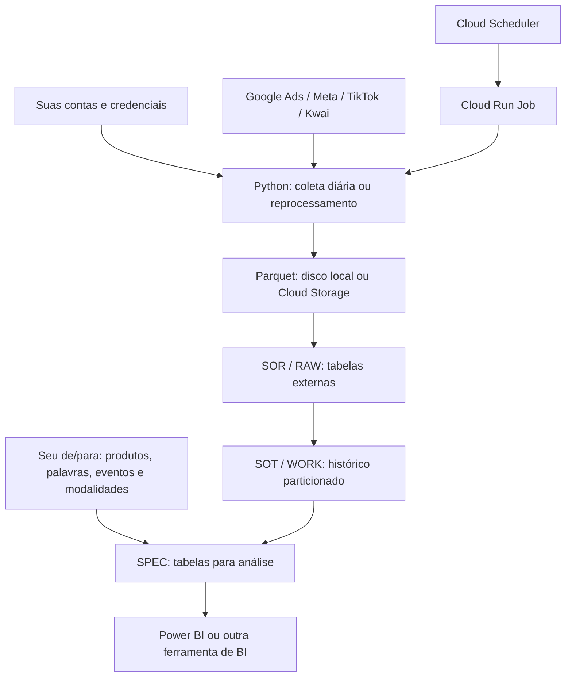

# Media Data Pipeline

**Das APIs de mídia paga às tabelas de análise: coleta, reprocessamento e transformação de dados com Python e BigQuery.**

Este projeto reúne coletores de Google Ads, Meta, TikTok e Kwai, persistência em Parquet e uma arquitetura SQL para preparar dados de campanhas, anúncios, conversões, eventos e alcance para BI.

A proposta é permitir que você utilize o pipeline com suas próprias contas e regras. Os parâmetros de acesso, produtos, classificação e infraestrutura ficam em arquivos de configuração. O repositório contém modelos fictícios; a coleta consulta as APIs reais depois que você configura seus acessos.

**Stack:** Python · Polars · SQL · BigQuery · Cloud Storage · Cloud Run Jobs · Cloud Scheduler · Secret Manager · Docker.

Para configurar seu ambiente, comece pelo [passo a passo de reutilização](docs/REUTILIZAR.md). Para entender o fluxo e as decisões técnicas, continue neste README.

## Navegação

- [O que o projeto entrega](#o-que-o-projeto-entrega)
- [Como os dados passam pelo pipeline](#como-os-dados-passam-pelo-pipeline)
- [Comece por aqui](#comece-por-aqui)
- [Configurar para suas contas e regras](#configurar-para-suas-contas-e-regras)
- [Executar e conferir os resultados](#executar-e-conferir-os-resultados)
- [Usar sua infraestrutura cloud](#usar-sua-infraestrutura-cloud)
- [Preparar e publicar os SQLs](#preparar-e-publicar-os-sqls)
- [Estrutura e pontos de personalização](#estrutura-e-pontos-de-personalização)
- [Validação e limites](#validação-e-limites)
- [Documentação e colaboração](#documentação-e-colaboração)

## O que o projeto entrega

- Coleta de métricas e eventos das quatro plataformas, com seleção dos canais utilizados.
- Catálogo de contas e produtos para aplicar sua dimensão de negócio.
- Execução diária e reprocessamento de períodos, com blocos e pausas configuráveis na CLI do reprocessador.
- Persistência em Parquet, com atualização por chaves e conservação de registros de outras chaves.
- Coleta de alcance semanal por período, evitando tratar alcance único como uma métrica aditiva.
- Camadas SQL de dados brutos, histórico particionado e tabelas destinadas à análise.
- Classificação por palavras e eventos, com de/para configurável de visão e modalidade.
- Docker e scripts para planejar ou publicar Cloud Run Jobs, Scheduler e definições SQL.

Você pode começar com coleta local e arquivos Parquet. O uso de Google Cloud e BigQuery é uma etapa adicional. As tabelas finais podem servir de fonte para Power BI ou outra ferramenta de BI; este repositório não inclui um dashboard pronto.

## Como os dados passam pelo pipeline



Em texto: **APIs → Python → Parquet → SOR → SOT → SPEC → BI**.

| Etapa | Entrada | Transformação e saída |
|---|---|---|
| Python | Contas, credenciais e período | Consulta os provedores, organiza métricas/eventos e atualiza Parquets |
| SOR / RAW | Parquets no bucket | Expõe os arquivos como tabelas externas do BigQuery |
| SOT / WORK | Tabelas externas e janela de atualização | Mantém o histórico em tabelas particionadas |
| CONFIG | Seu CSV de classificação | Fornece regras de produto, veículo, visão, palavra/evento e modalidade |
| SPEC | Histórico e regras CONFIG | Produz tabelas de detalhe, eventos, semana, mês e anúncio para análise |

O Scheduler dispara o job de coleta Python. A publicação das definições SQL e a execução da procedure que atualiza os dados são etapas separadas. Nesta versão, concluir o job de coleta não dispara automaticamente o SQL.

## Comece por aqui

### 1. Prepare o ambiente

Clone o repositório e abra o terminal na pasta do projeto. Você também pode baixar e extrair o ZIP pelo GitHub. Os exemplos usam **PowerShell e Python 3.11 ou superior**.

```powershell
git clone https://github.com/lucascsm/media-data-pipeline.git
Set-Location media-data-pipeline
```

```powershell
python -m venv .venv
.\.venv\Scripts\python.exe -m pip install -r requirements.txt
```

As dependências incluem os SDKs dos provedores e bibliotecas de dados. No Windows, `tzdata` fornece a base de fusos utilizada por `ZoneInfo`.

### 2. Escolha um canal para começar

Este exemplo utiliza somente Google Ads:

```powershell
.\.venv\Scripts\python.exe scripts/configure.py --init --channels google
```

O comando cria `config/google.yaml`, `config/accounts.yaml`, `config/cloud.local.json` e `config/depara_visao_eventos.local.csv`. Se um arquivo já existir, seu conteúdo será preservado.

Para adicionar canais, use `--channels google,meta`, por exemplo. As opções do inicializador são `google`, `meta`, `tiktok` e `kwai`.

### 3. Preencha seus parâmetros

Edite `config/google.yaml` com suas credenciais Google Ads e `config/accounts.yaml` com suas contas e produtos. Exemplo fictício de catálogo:

```yaml
accounts:
  - platform: google
    account_id: "REPLACE_WITH_YOUR_ACCOUNT_ID"
    product: "Cursos online"
    aggregate_conversions: false
product_aliases:
  cursos: "Cursos online"
```

Troque o placeholder pelo seu ID antes de continuar. O nome do produto é definido por você. IDs devem ser strings; a combinação plataforma + conta deve ser única. Para coletar localmente, você pode deixar a configuração cloud e o CSV para uma etapa posterior.

### 4. Confira a configuração

```powershell
.\.venv\Scripts\python.exe scripts/configure.py --check --channels google
```

O checker aponta arquivos ausentes, campos pendentes, placeholders e duplicidades do catálogo. Ele informa os campos sem mostrar os valores das credenciais. A mensagem esperada é:

```text
Configuracao local validada. Autenticacao e disponibilidade das APIs nao foram testadas.
```

Essa conferência é local. A validade do token e o acesso às contas serão conhecidos durante a chamada real ao provedor.

### 5. Faça a primeira coleta

Escolha um período curto para conferir seus dados. As datas abaixo são exemplos:

```powershell
New-Item -ItemType Directory -Force data/output/backup | Out-Null
.\.venv\Scripts\python.exe -m src.main_reprocess --channels google --start_date 2025-01-01 --end_date 2025-01-07
```

**Este comando consulta a API e grava arquivos locais.** O reprocessador executa as etapas de coleta e alcance do canal para o período informado. Confira o resumo de sucessos/falhas e os Parquets em `data/output` antes de ampliar o período ou conectar o BI.

## Configurar para suas contas e regras

| Arquivo local | Parâmetros | Modelo público |
|---|---|---|
| `config/accounts.yaml` | Plataforma, conta, produto, aliases e opção de conversões | [accounts.example.yaml](config/accounts.example.yaml) |
| `config/google.yaml` | Developer token, credenciais OAuth e conta gerente opcional | [google.example.yaml](config/google.example.yaml) |
| `config/meta.yaml` | App ID, app secret e access token | [meta.example.yaml](config/meta.example.yaml) |
| `config/tiktok.yaml` | Access token e campos opcionais das demais operações | [tiktok.example.yaml](config/tiktok.example.yaml) |
| `config/kwai.yaml` | Access token ou configuração de renovação | [kwai.example.yaml](config/kwai.example.yaml) |
| `config/depara_visao_eventos.local.csv` | Suas palavras, eventos, visões, prioridades e modalidades | [depara_visao_eventos.example.csv](config/depara_visao_eventos.example.csv) |
| `config/cloud.local.json` | Projeto, buckets, datasets, jobs, imagem, agenda e secrets | [cloud.example.json](config/cloud.example.json) |

Os arquivos locais criados pelo inicializador estão ignorados pelo Git e pelo contexto de build. Preencha somente os provedores que utilizar. O login no Google Cloud não substitui as credenciais das plataformas de anúncios.

Algumas escolhas precisam corresponder ao seu ambiente:

- **Contas Meta:** use o prefixo `act_` esperado pelo SDK. Cada plataforma/conta recebe um único produto no catálogo.
- **Conversões Google:** `aggregate_conversions: true` ativa uma ramificação de agregação por conta. Valide a granularidade e os resultados antes de habilitá-la.
- **Conta gerente Google:** habilite `login_customer_id` no YAML se o acesso passar por uma conta gerente; o modelo deixa esse campo comentado.
- **Kwai:** com access token, os campos opcionais podem ficar vazios. Para renovação, configure `refresh_token`, `client_id` e `secret_key` juntos.
- **Classificação:** os produtos do catálogo devem corresponder ao seu de/para. Palavras e eventos do CSV são fictícios; substitua-os pelos utilizados nas suas campanhas e retornados pelas APIs.

### Caminhos e variáveis de ambiente

| Variável | Padrão | Uso |
|---|---|---|
| `CONFIG_DIR` | `config/` na raiz do projeto | Diretório dos YAMLs |
| `ACCOUNT_CATALOG_PATH` | `CONFIG_DIR/accounts.yaml` | Caminho do catálogo |
| `GCS_MOUNT` | `data/` na raiz do projeto | Diretório base dos dados |
| `OUTPUT_PATH` | `GCS_MOUNT/output` | Diretório dos Parquets e backups |
| `PIPELINE_TIMEZONE` | `America/Sao_Paulo` | Fuso do runner diário |

Por exemplo, para manter as configurações em outro diretório:

```powershell
$env:CONFIG_DIR = 'C:\media-config'
.\.venv\Scripts\python.exe scripts/configure.py --init --channels google
.\.venv\Scripts\python.exe scripts/configure.py --check --channels google
```

Use o mesmo `CONFIG_DIR` no checker e nos coletores. A opção `--config-dir` altera apenas o diretório conferido pelo checker.

[.env.example](.env.example) documenta as variáveis; o programa não carrega arquivos `.env` automaticamente. Kwai também aceita os overrides `KWAI_*` descritos em seu carregador. O modelo SharePoint registra campos opcionais e não acrescenta uma integração ao fluxo principal.

## Executar e conferir os resultados

### Modos de execução

Depois de configurar e conferir os canais escolhidos:

```powershell
# Daily collection
.\.venv\Scripts\python.exe -m src.main --channels google

# Reprocess a chosen period
.\.venv\Scripts\python.exe -m src.main_reprocess --channels google,meta --start_date 2025-01-01 --end_date 2025-01-07

# Reprocess weekly reach only
.\.venv\Scripts\python.exe -m src.main_reprocess --channels google,meta,tiktok --start_date 2025-01-01 --end_date 2025-01-31 --reach-only
```

Todos esses modos consultam APIs reais. A coleta diária usa as janelas e pausas definidas no runner; o reprocessador permite configurar blocos e pausas por lote. Consulte as opções sem executar a coleta:

```powershell
.\.venv\Scripts\python.exe -m src.main --help
.\.venv\Scripts\python.exe -m src.main_reprocess --help
```

### Arquivos de saída

Por padrão, os coletores gravam em `data/output`. As saídas dependem dos canais executados e dos dados retornados:

| Arquivo | Conteúdo |
|---|---|
| `dados_google_ads_all_new.parquet` | Performance Google Ads |
| `google_ads_conversions_all_new.parquet` | Conversões Google Ads |
| `meta_ads_data_all_new.parquet` | Métricas e eventos Meta |
| `dados_tiktok_all_new.parquet` | Métricas e eventos TikTok |
| `dados_kwai_all_new.parquet` | Métricas e eventos Kwai |
| `alcance_semanal_all_new.parquet` | Alcance/frequência semanal |
| `alcance_semanal_grupo_anuncio_all_new.parquet` | Alcance semanal na granularidade de grupo de anúncio |

Os backups usam `data/output/backup`. O reprocessamento substitui as métricas das chaves presentes na nova extração e conserva registros de outras chaves.

Após cada execução, confira os canais/contas processados, datas, contagens e totais. O runner mantém isolamento por etapa e imprime um resumo; a mensagem final de término, sozinha, não confirma sucesso de todas as etapas.

### Cuidados com métricas e granularidade

- **Investimento:** não some os mesmos gastos nos níveis de campanha, grupo e anúncio.
- **Eventos em formato longo:** dimensões de performance podem aparecer em várias linhas de eventos. Use a camada adequada para evitar multiplicação de métricas.
- **Alcance:** não some dias, campanhas ou contas para obter alcance único de um período maior. Use a consulta do provedor para esse período.
- **De/para:** mantenha modalidade única por produto + veículo + visão. Lookup escalar com `SELECT DISTINCT` evita multiplicação por join e expõe conflitos.
- **Concorrência:** evite duas execuções escrevendo o mesmo arquivo/período ao mesmo tempo.

Veja exemplos e orientações em [cuidados com o BI](docs/manual_dashboard_semanal.md).

## Usar sua infraestrutura cloud

Esta etapa exige seu projeto Google Cloud, bucket, credenciais dos provedores, secrets, autenticação CLI e permissões para criar/atualizar recursos. Os planos podem ser gerados localmente sem `gcloud`; a publicação exige as ferramentas e acessos do seu ambiente.

### Configuração e secrets

Preencha `config/cloud.local.json`. Em `config_secrets`, cada referência aponta para um secret do Secret Manager cujo conteúdo é o **YAML completo** do provedor ou do catálogo.

Para um job somente Google, configure `google.yaml` e `accounts.yaml`. Esses arquivos são montados em `/app/config`; não é necessário preencher os secrets dos outros canais. O deploy não copia credenciais para a imagem.

```powershell
.\.venv\Scripts\python.exe scripts/configure.py --check --channels google --cloud
```

O checker confere os parâmetros locais, sem consultar a existência dos recursos ou a validade das credenciais cloud.

### Planejar e publicar o job

Primeiro, gere o plano. **Sem `-Apply`, estes comandos não publicam recursos nem executam jobs:**

```powershell
.\deploy_automation.ps1 -ConfigPath config/cloud.local.json -Channels google -PythonExecutable .\.venv\Scripts\python.exe
.\deploy_automation.ps1 -ConfigPath config/cloud.local.json -RunMode reprocess -StartDate 2025-01-01 -EndDate 2025-01-07 -Channels google -PythonExecutable .\.venv\Scripts\python.exe
```

Para publicar no seu ambiente, adicione `-Apply`. No primeiro deploy, `-InitializeResources` habilita APIs, cria service account/repositório se ausentes e concede permissões ao job. Ela pressupõe que bucket e secrets já existam:

```powershell
.\deploy_automation.ps1 -ConfigPath config/cloud.local.json -Channels google -PythonExecutable .\.venv\Scripts\python.exe -InitializeResources -Apply
```

As permissões de BigQuery e Secret Manager são concedidas no projeto; confira o escopo que deseja utilizar. A service account precisa acessar os YAMLs e ler/gravar no bucket, além das permissões de execução do job.

| Modo | Recurso publicado | Agenda |
|---|---|---|
| `daily` | Job de coleta diária | Configura o Scheduler |
| `reprocess` | Job separado para o período informado | Sem agenda |
| `reach` | Job separado para alcance semanal | Sem agenda |

O deploy publica os recursos e não executa imediatamente o job. A execução precisa ser iniciada no seu ambiente ou pelo Scheduler, no modo diário.

O wrapper Bash utiliza o mesmo planner: `bash deploy_mac.sh --config config/cloud.local.json --mode daily --channels google`. Adicione `--apply` para publicar. A limpeza de imagens antigas é opcional, com `-PruneImages -KeepImages 10 -Apply` no PowerShell.

O Scheduler usa OAuth para `run.googleapis.com`, conforme a [documentação do Google Cloud](https://docs.cloud.google.com/scheduler/docs/http-target-auth?hl=en). A configuração de deploy precisa ser validada na sua conta cloud.

## Preparar e publicar os SQLs

### 1. Defina sua classificação e as fontes

Edite `config/depara_visao_eventos.local.csv` a partir do [modelo](config/depara_visao_eventos.example.csv). O schema contém:

```text
produto;veiculo;visao;valor;valor_amigavel;prioridade;tipo_linha;evento_principal;modalidade
```

Substitua os exemplos por seus produtos, palavras e eventos. A carga espera o CSV no bucket em `output/depara visao-evento.csv`, com delimitador `;`.

Os Parquets referenciados pela SOR também precisam estar no bucket. **A seleção `--channels` controla a coleta Python; a publicação SQL padrão inclui os quatro provedores.** Se utilizar somente parte deles, revise as definições SQL e a orquestração para corresponder às fontes disponíveis antes de publicar.

### 2. Gere os SQLs com seus parâmetros

Os arquivos SQL usam placeholders como `${PROJECT_ID}`, `${DATASET_RAW}` e `${DATA_BUCKET}`:

```powershell
.\.venv\Scripts\python.exe scripts/render_sql.py --config config/cloud.local.json
```

As cópias resolvidas ficam em `rendered_sql/`, ignorado pelo Git. A renderização resolve todos os 72 SQLs atuais, históricos e de diagnóstico; ela não executa consultas nem valida os SQLs no BigQuery.

### 3. Confira a ordem de publicação

```powershell
.\deploy_sql.ps1 -ConfigPath config/cloud.local.json -PythonExecutable .\.venv\Scripts\python.exe
```

O plano seleciona **CONFIG → SOR → DDL SOT → procedures SOT → procedures SPEC → orquestração**. SQLs históricos, diagnósticos e recuperação não entram na publicação automática.

### 4. Publique no seu BigQuery

Depois de preparar as fontes e conferir o plano:

```powershell
.\deploy_sql.ps1 -ConfigPath config/cloud.local.json -PythonExecutable .\.venv\Scripts\python.exe -Apply
```

Esse comando cria datasets, carrega/sobrescreve CONFIG e publica as tabelas/procedures selecionadas. Ele não executa a atualização dos dados pela procedure de orquestração.

### 5. Atualize os dados

Após coleta e publicação, confira e execute separadamente o CALL do arquivo renderizado `nova_arquitetura_big_query/orquestracao/roda_pipeline.sql` no seu BigQuery. Valide cobertura, datas, contagens e totais nas tabelas finais antes de atualizar o BI.

`special_product` define o produto que recebe o fallback de modalidade; `special_product_normalized` deve conter o mesmo nome em minúsculas. `view_alias` e `view_canonical` definem a equivalência de uma visão. Datas de diagnóstico e corte de recuperação também ficam no JSON.

## Estrutura e pontos de personalização

| Pasta ou arquivo | Responsabilidade |
|---|---|
| [src/main.py](src/main.py) | Coleta diária, janelas automáticas e reprocessamento simples |
| [src/main_reprocess.py](src/main_reprocess.py) | Reprocessamento por blocos/lotes e alcance semanal |
| `src/google_ads.py`, `metads.py`, `tiktok.py`, `kwai.py` | Chamadas aos provedores, organização das métricas e persistência |
| [src/account_catalog.py](src/account_catalog.py) | Leitura e validação do catálogo de conta/produto |
| [src/event_long_format.py](src/event_long_format.py) | Conversão de eventos para formato longo |
| [src/alcance_semanal.py](src/alcance_semanal.py) | Consulta de alcance/frequência por período |
| [config/](config/) | Modelos de configuração |
| [nova_arquitetura_big_query/](nova_arquitetura_big_query/) | SQLs CONFIG, SOR, SOT, SPEC, orquestração e validação |
| [fluxo_antigo/](fluxo_antigo/) | Fluxos históricos e configurações genéricas próprias |
| `weekly_reports.py`, `scripts/exporta_frequencia_semanal_produto.py` | Utilitários de relatórios/exportação |
| [scripts/configure.py](scripts/configure.py) | Criação e conferência das configurações locais |
| `deploy_automation.ps1`, `deploy_mac.sh`, `scripts/deploy_job.py` | Plano e publicação Cloud Run/Scheduler |
| `deploy_sql.ps1`, `scripts/deploy_sql.py`, `scripts/render_sql.py` | Renderização, plano e publicação SQL |
| `Dockerfile`, `.dockerignore`, `.gcloudignore` | Imagem e contexto de build |
| [tests/](tests/) | Testes locais com dados fictícios |

Para evoluir a implementação:

- Altere contas, produtos e aliases no catálogo; regras de classificação no CSV; infraestrutura no JSON.
- Use a CLI do reprocessador para mudar períodos, blocos e pausas.
- Ajuste as constantes `DAILY_*` e `WEEKLY_REACH_WINDOW_DAYS` em `src/main.py` para mudar as janelas automáticas de coleta.
- Ajuste os `DECLARE`s em `nova_arquitetura_big_query/orquestracao/sp_run_pipeline_midia.sql` para mudar as janelas SQL e confira a relação com a cobertura dos arquivos coletados.
- Modifique os coletores e SQLs quando precisar de novos campos, outras granularidades ou tratamento diferente de moedas/métricas. Essas mudanças exigem validação própria.

O fluxo histórico requer `legacy.yaml`, criado de `config/legacy.example.yaml`. Orçamentos, metas, URLs e eventos são exemplos configuráveis. Alguns módulos históricos fazem chamadas ou leem arquivos ao serem importados/executados; eles não integram o deploy SQL padrão. O módulo de recomendações usa `GEMINI_API_KEY` e envia seus dados ao provedor quando executado.

## Validação e limites

### Verificações locais

Depois de instalar as dependências:

```powershell
.\.venv\Scripts\python.exe -m unittest discover -s tests -v
.\.venv\Scripts\python.exe -m compileall -q src scripts fluxo_antigo
.\.venv\Scripts\python.exe scripts/check_public_files.py
```

Os testes usam dados fictícios e diretórios temporários. A validação local registrada inclui **14 testes**, cobrindo atualização das métricas dos quatro provedores, conservação de arquivos em extrações vazias de Meta/TikTok/Kwai, catálogo, datas, eventos, configurações e planos de deploy sem chamadas cloud. Consulte [as evidências e o escopo da validação](docs/VALIDACAO_LOCAL.md).

### O que depende do seu ambiente

Autenticação e permissões das APIs, build Docker, publicação BigQuery e execução Cloud Run/Scheduler precisam ser validados com seus recursos. A equivalência foi verificada sobre arquivos locais e casos sintéticos; não houve comparação com imagem publicada ou execução em produção nesta preparação.

As dependências não têm lockfile. Os testes utilizaram um ambiente Python existente e `tzdata` para Windows; uma instalação limpa ainda precisa ser validada. APIs, SDKs, tokens expirados e ausência de dados/eventos podem afetar a operação.

| Situação | Onde conferir |
|---|---|
| Checker aponta campos pendentes | YAML do canal e `accounts.yaml`; substitua os placeholders |
| Catálogo acusa duplicidade | Combinação plataforma + conta e produto correspondente |
| API falha ou retorna dados incompletos | Resumo da execução, acesso às contas, período e eventos retornados |
| Coleta termina, mas BigQuery continua desatualizado | Fontes no bucket, publicação SQL e execução separada do CALL |
| Métricas aparecem multiplicadas no BI | Nível de análise, linhas de eventos e regras do de/para |

## Documentação e colaboração

- [Configurar e reutilizar com seus parâmetros](docs/REUTILIZAR.md)
- [Granularidade e cuidados com o BI](docs/manual_dashboard_semanal.md)
- [Validação do de/para e modalidade](docs/validacao_modalidade_depara.md)
- [Evidências da validação local](docs/VALIDACAO_LOCAL.md)

Para propor uma melhoria, descreva o problema, as entradas, a saída esperada e como validar o resultado. Use exemplos fictícios e retire credenciais, IDs privados e dados de clientes antes de compartilhar logs ou arquivos.

### Preparar a publicação

Faça o commit a partir da pasta deste projeto. Confira os arquivos candidatos e, depois de adicioná-los, revise também o índice:

```powershell
.\.venv\Scripts\python.exe scripts/check_public_files.py
git status --short
git add .
.\.venv\Scripts\python.exe scripts/check_public_files.py
git diff --cached --stat
```

O checker é uma proteção adicional e não substitui a revisão dos arquivos. Evite `git add -f` em configurações, dados ou credenciais. O pacote distribuído não inclui esses artefatos nem o histórico Git de origem.

Para gerar um ZIP atualizado com os arquivos revisados:

```powershell
.\.venv\Scripts\python.exe scripts/package_public.py
```

### Licença

Este repositório ainda não contém um arquivo `LICENSE`. Defina uma licença antes da publicação para esclarecer as condições de uso, modificação e distribuição do código.
